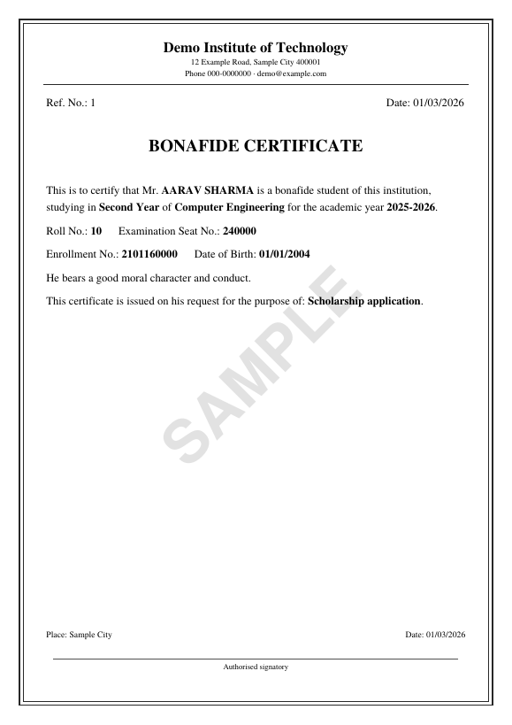
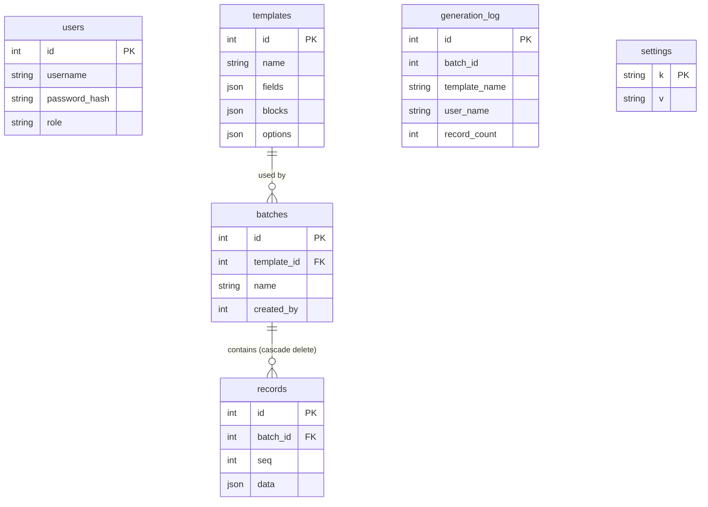

# CertGen

**Design a certificate once. Upload a spreadsheet. Download hundreds of PDFs.**

CertGen is a self-hosted web app for producing certificates in bulk. You define a *template*
(the data fields and the printed layout), upload an Excel or CSV sheet, match its columns to the
template, review the records, and generate either one combined PDF or a ZIP with one PDF per person.

It is not tied to any one document type. Leaving certificates, bonafide letters, course-completion
certificates, experience letters, ID letters, no-dues slips, event participation certificates: anything
that is "one template, many rows of data" works. Two presets (Leaving Certificate and Bonafide Certificate)
are included.

| Leaving Certificate preset | Bonafide Certificate preset |
| :---: | :---: |
|  |  |

*Generated from the fake data in [`samples/`](samples). Full PDFs: [`docs/sample-leaving.pdf`](docs/sample-leaving.pdf), [`docs/sample-bonafide.pdf`](docs/sample-bonafide.pdf).*

---

## Why this exists

CertGen began as a diploma capstone project (2023–24) built by a four-person team to automate the
**leaving certificate** and **bonafide certificate** paperwork at a polytechnic college. The original
worked, but it was hard-wired to one institution: its layout, branding and database tables were fixed in code.

This repository is a **ground-up rewrite** that keeps the part that was genuinely good, bulk generation from
an Excel upload, and makes it general:

| Original | This version |
| --- | --- |
| Two hard-coded certificate types | Any certificate, defined as a template (fields + layout) in the browser |
| One MySQL table per year/department created at runtime | Fixed schema; records stored per batch |
| Fixed Excel column order | Upload any sheet; columns are matched to fields (auto-detected, adjustable) |
| Institution name and logo in code | Name, address, logo, date format and watermark set in *Settings* |
| String-built SQL | Prepared statements everywhere |
| Credentials in source | No default accounts; first-run setup creates your admin |
| MySQL only | SQLite (zero setup) or MySQL/MariaDB |

## Features

- **Template designer.** Fields with types (text, date, number, required/optional) plus a block-based page layout: heading, paragraph, label–value line, two columns, spacing, rule. Live **PDF preview** with sample data.
- **Placeholders and filters.** `{{full_name|upper}}`, `{{dob|date_words}}` → *Twelfth of June Two Thousand and Five*, `{{gender|map:M=He,F=She,*=They}}`, `{{dob|date:d F Y}}`, `**bold**` inline.
- **Spreadsheet import.** `.xlsx`, `.xls` and `.csv` (BOM, `;`/tab delimiters and Windows-1252 handled). Real Excel dates are understood. A column-mapping screen shows what will go where, and rows with problems are skipped and reported with their row numbers. Nothing is saved until you confirm.
- **Review before printing.** Search, paginate, edit, add and delete records.
- **Bulk output.** One PDF with a page per record, or a ZIP of individual PDFs. Choose the issue date and starting serial number.
- **Issue log.** Who generated how many certificates, and when.
- **Accounts.** Administrator and staff roles, hashed passwords, login lock-out after repeated failures.
- **Safe to demo.** `DEMO_MODE` adds a banner and a SAMPLE watermark to every PDF.

## Live Demo

🔗 **[Visit the Website](https://certgen-2gbo.onrender.com/)**

> The application is deployed on Render and can be accessed through the link above.
> 
## Requirements

- PHP **8.0 or newer** with the `pdo`, `mbstring`, `zip` and `gd` extensions (all on by default in XAMPP)
- [Composer](https://getcomposer.org) (installs FPDF and PhpSpreadsheet)
- Nothing else for SQLite. MySQL/MariaDB is optional.

## Quick start

### Any OS: PHP's built-in server

```bash
git clone <your-repo-url> certgen
cd certgen
composer install
php -S localhost:8000 -t public
```

Open <http://localhost:8000>. On first run you create the administrator account, and the two preset templates are installed.
Then try **Batches → New batch**, choose *Bonafide Certificate*, and upload [`samples/bonafide_sample.xlsx`](samples/bonafide_sample.xlsx).

### Windows with XAMPP

1. Install [XAMPP](https://www.apachefriends.org) and [Composer](https://getcomposer.org/download/).
2. Copy this folder to `C:\xampp\htdocs\certgen`.
3. In that folder run `composer install`.
4. Start **Apache** in the XAMPP control panel and open <http://localhost/certgen/>.

SQLite is used by default, so you do not need to start MySQL. To use MySQL, see below.

### Docker

```bash
docker compose up --build
```

Open <http://localhost:8080>. Data persists in a Docker volume. *(The Dockerfile is provided but has not been run in CI; if you hit a problem, please open an issue.)*

### Using MySQL / MariaDB

Create an empty database, then either copy `config/config.example.php` to `config/config.php` and edit it, or set environment variables:

```
DB_DRIVER=mysql  DB_HOST=127.0.0.1  DB_NAME=certgen  DB_USER=root  DB_PASS=
```

Tables are created automatically on first load.

### Command-line helpers

```bash
php bin/create_admin.php alice 'a-long-password'   # create or reset an administrator
php bin/make_samples.php                            # regenerate the fake sample spreadsheets
```

## Configuration

| Setting (env var) | Default | Purpose |
| --- | --- | --- |
| `DB_DRIVER` | `sqlite` | `sqlite` or `mysql` |
| `DB_PATH` | `storage/certgen.sqlite` | SQLite file location |
| `DB_HOST`, `DB_PORT`, `DB_NAME`, `DB_USER`, `DB_PASS` | | MySQL connection |
| `DEMO_MODE` | `false` | Banner plus SAMPLE watermark on every PDF |
| `APP_NAME` | `CertGen` | Name shown in the interface |
| `APP_TIMEZONE` | `Asia/Kolkata` | PHP timezone |

Institution name, address, logo, place, date format and watermark are edited in the app under **Settings**.
Upload and PDF size limits are in `config/config.example.php`.

## How a template works

A template is **fields** + **blocks** + **options**, stored as JSON:

```text
Fields   full_name (text, required) · gender (text) · date_of_birth (date) · course (text) ...
Blocks   heading   "BONAFIDE CERTIFICATE"
         row       "Ref. No.: {{record_no}}"  |  "Date: {{issue_date}}"
         text      "This is to certify that {{gender|map:M=Mr.,F=Ms.}} **{{full_name|upper}}** is a student of **{{course}}** ..."
Options  font · text size · header on/off · border · signature labels · footer note
```

Built-in placeholders: `serial_no`, `record_no`, `issue_date`, `today`, `org_name`, `org_address`, `org_contact`, `place`.
The in-app **Help** page lists every filter.

## Project structure

```text
public/        Web root: one PHP file per page, plus assets/ (CSS, JS)
src/           Db, Auth, CertTemplate, Presets, Importer, Placeholder, PdfRenderer, helpers
config/        config.example.php (copy to config.php to customise)
storage/       SQLite file, uploaded logo, temporary uploads (git-ignored)
samples/       Fake spreadsheets for trying the app
tests/         run.php (unit tests) and smoke.sh (end-to-end)
bin/           CLI helpers
docs/          Sample PDFs and previews
```

Point your web server's document root at `public/`. If you cannot (some shared hosting), the root `index.php`
redirects into it and `.htaccess` files block direct access to `src/`, `config/`, `storage/` and `tests/`.

### Data model



Record values live in one JSON column, which is what lets a single schema serve any template.

## Security

- All SQL uses prepared statements; search input is escaped for `LIKE` wildcards.
- Passwords are hashed with `password_hash` (bcrypt); sessions are regenerated on login; cookies are `HttpOnly` + `SameSite=Lax`.
- Every state-changing request carries a CSRF token.
- Login is throttled: 5 failures in 10 minutes locks that username and IP for the window.
- Output is HTML-escaped; a Content-Security-Policy, `X-Frame-Options` and `nosniff` are sent.
- Uploads are limited by size and extension, stored under random names outside the web root, and deleted after import. Logos are verified as real PNG/JPG images.
- No default credentials exist anywhere in the code.

If you deploy publicly: serve over HTTPS, use a strong admin password, and consider `DEMO_MODE=true` for any shared demo.

## Testing

```bash
php tests/run.php     # 71 unit tests: filters, date parsing, importer, template validation, DB, PDF
bash tests/smoke.sh   # 51 end-to-end checks against a live server (needs curl and poppler-utils)
```

Both suites were run against SQLite and MySQL/MariaDB. CI is set up in `.github/workflows/ci.yml`.

## Known limitations

- **Fonts.** PDFs use FPDF's built-in fonts, which cover Western European characters only. Text in other scripts (e.g. Devanagari) prints as `?`; the import screen warns you when it detects this. Supporting those scripts means switching the renderer to a Unicode-capable library (mPDF or TCPDF) with an embedded font.
- A5/landscape pages and custom page sizes are not supported yet (A4 portrait only).
- Imports read the first sheet of a workbook only.
- Record search is a plain substring match across all values (it can also match field names).
- No password-reset email; administrators reset passwords from the Users page.

## Roadmap

- Unicode fonts for Indian-language certificates
- QR code / verification ID on each certificate
- Page size and orientation per template
- Template import/export as JSON, to share designs
- Export a batch back to Excel

## Credits

Originally developed as a team diploma project (2023–24).
This version is a rewrite by *Susmita Sahu*.

Built with [FPDF](http://www.fpdf.org), [PhpSpreadsheet](https://github.com/PHPOffice/PhpSpreadsheet) and [Bootstrap](https://getbootstrap.com).

## License

[MIT](LICENSE)
